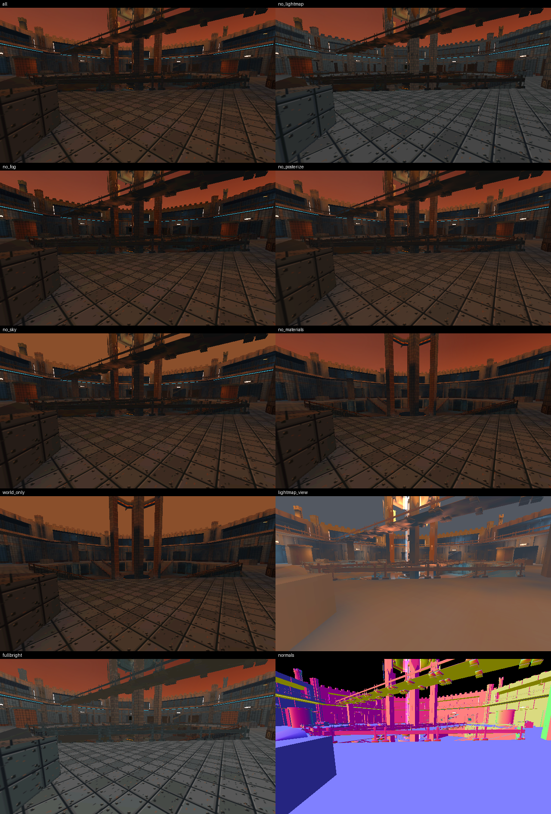

# Cat Arena: Feral Claw — N2: Helios Crucible rendered natively

N2 implemented and tested, 2026-11-09. Continue from this complete project (N0, N1 and all
original references are included unchanged).

**The real Helios Crucible map renders in the native C++20/Vulkan engine and matches the legacy
WebGL2 game frame-for-frame on the same software rasterizer** (7 poses, mean difference 0.03-0.17
levels per channel, PSNR 49-56 dB). It is a static map view: no movement physics, enemies,
weapons, effects, HUD or audio yet.



## Start

```sh
# GPU-free core + scene tests (no SDL/Vulkan needed)
cmake -S native -B build-core -G Ninja -DCAT_BUILD_DESKTOP=OFF -DCMAKE_BUILD_TYPE=Debug
cmake --build build-core && ctest --test-dir build-core --output-on-failure

# Desktop (SDL3 + Vulkan). The preset fetches SDL3 3.2.10 and needs a Vulkan SDK; it was not
# executed in this runner, which used the explicit configuration in docs/BUILD.md (N2 section).
cd native && cmake --preset desktop-debug && cmake --build --preset desktop-debug
./build/desktop-debug/cat_arena                   # window: click to capture mouse, WASD/Space/Ctrl fly
./build/desktop-debug/cat_arena --offscreen 1280x720 --capture helios.png --time 10
```

## What to read

- docs/N2_RENDERER.md — design and the legacy rule each part reproduces
- docs/DEVELOPMENT_LOG_N2.md — what happened, including two N1 data corrections and one fixed
  winding bug and one retracted tooling conclusion
- docs/TEST_MATRIX.md, docs/n2-evidence/ — every result with logs, frames and comparison sheets
- assets/n2/PROVENANCE.md — the runtime world atlas and the texture audit
- docs/KNOWN_LIMITATIONS.md — what N2 does not do

Verified here: Linux x86_64 (Ubuntu 24.04), Mesa lavapipe software Vulkan, Khronos validation
clean. NOT run: hardware GPUs, Windows, Android. No EXE/APK is supplied.

Next: **N3 — physics and first-person traversal** on the baked collision data.
