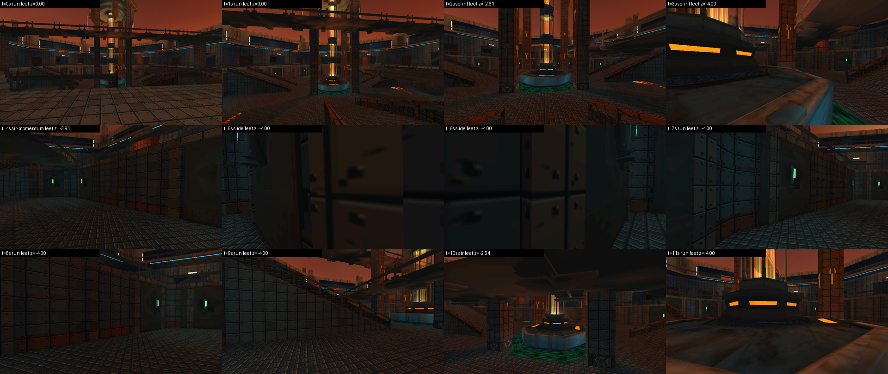

# Cat Arena: Feral Claw — N3: physics and first-person traversal

N3 implemented and tested, 2026-11-10. This package contains N0, N1, N2, N2.1 and N3; the original
references are unchanged.

**You can walk through Helios Crucible in the native engine.** Walk, sprint, crouch, slide, jump,
air-strafe and jump pads run at a fixed 120 Hz against the real map collision (stacked floors,
deck undersides, ramps, stairs, walls). The movement was checked against the unmodified legacy
game: 17 recorded input tapes, 181.8 s, every value within 1.8e-15, all contact counts equal.



No enemies, weapons, HUD or audio yet.

## Start

```sh
cmake -S native -B build-core -G Ninja -DCAT_BUILD_DESKTOP=OFF -DCMAKE_BUILD_TYPE=Debug   # no GPU needed
cmake --build build-core && ctest --test-dir build-core --output-on-failure            # includes the physics tests

./build-desktop/cat_arena               # click to capture the mouse; WASD, Shift sprint, Space jump, Ctrl crouch, C slide
./build-desktop/cat_arena --spawn 12    # another spawn point; --fly for the old fly camera
```

## What to read

- docs/N3_PHYSICS.md — what was ported, constants, the crouch-collider note, determinism, limits
- docs/TEST_MATRIX.md and docs/n3-evidence/ — results and logs
- docs/DEVELOPMENT_LOG_N3.md, docs/N3_DIFF.md
- docs/KNOWN_LIMITATIONS.md

Verified here: Linux x86_64, GCC and clang, Mesa lavapipe. NOT run: Windows (including its
keyboard/mouse capture), Android, hardware GPUs. No EXE/APK is supplied.

Next: **N4 — all four maps and navigation topology**.
