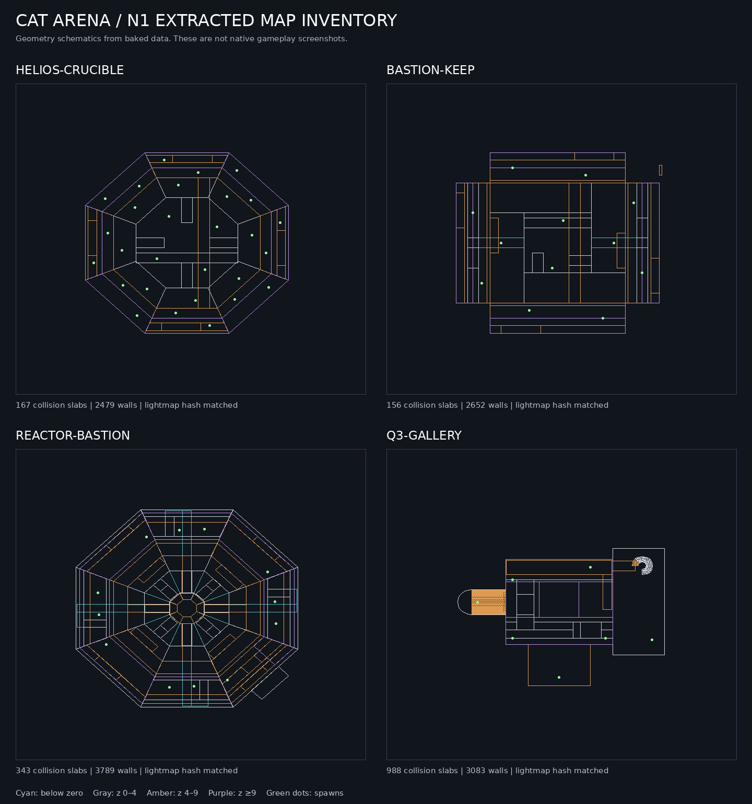

# N1 extracted content inventory

All counts below come from actual baked data. These are data/mesh counts, not runtime performance measurements.

| Map | Collision slabs | Ramp planes | Wall segments | Spawns | Kit placements | World triangles | Material triangles |
|---|---:|---:|---:|---:|---:|---:|---:|
| helios-crucible | 167 | 8 | 2479 | 28 | 420 | 7308 | 161014 |
| bastion-keep | 156 | 10 | 2652 | 12 | 339 | 5462 | 126814 |
| reactor-bastion | 343 | 20 | 3789 | 12 | 0 | 24398 | 0 |
| q3-gallery | 988 | 931 | 3083 | 7 | 0 | 2398 | 1000 |

Ramp counts include tessellated patch collision planes: The Arsenal has931 such planes, not931 authored staircases. Each map also retains1142 source sky triangles. World and material streams are separate and both required.

| Map | Shipped and recomputed lightmap hash |
|---|---|
| helios-crucible | `8ef1b586-1024x567` |
| bastion-keep | `2c71e476-1024x438` |
| reactor-bastion | `aa6afd0f-1024x792` |
| q3-gallery | `1eca3ff9-512x236` |

All four exact hashes and image dimensions match. Texture/material visual correctness still requires native rendering.

- 16 weapon meshes and20 enemy meshes, preserving their individual source metadata/textures.
- 40 fitted modular kit meshes with raw buffers and diffuse glTF inspection exports.
- Original Cat Marine:21 joints,7 named clips, supplied hit volumes and textures.
- 48 Ogg SFX; primary embedded music retained separately from the alternate soundtrack branch.
- 88 cataloged procedural/kit/glow/weapon-atlas texture entries, plus model and embedded textures.165 extracted PNG/JPEG/WebP files decode successfully.
- Four lightmap PNGs and four original visibility sets.
- Native-readable source weapon/enemy/movement constants; no native gameplay implementation claim.
- 577 content files plus conversion manifest; two clean bakes are byte-identical.

Per-map SVG previews are under assets/n1/previews. The image shows authored slab outlines and spawn points; it is a schematic, not a rendered map.
