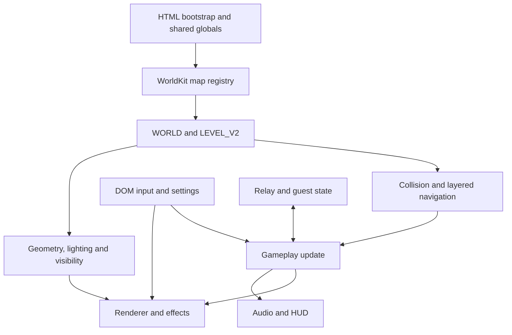

# Cat Arena — Step 01 source audit

Date: 2026-11-08 (America/Los_Angeles). Migration checkpoint: `migration-0.1-audit`.
Phase 0, Step 01: COMPLETE as a source-location audit, with explicit missing-input findings. No native subsystem is implemented. Runtime parity is unverified.

## 1. Reference selection and audit scope

The newest located game artifact is **CAT_ARENA_FERAL_CLAW_v0_17_CAT_MARINE_PLAYABLE.html**, created 2026-11-08T22:34:20Z. It is preserved byte-for-byte as `legacy_web/index.html` (18,320,927 bytes, 17,100 lines, 55 inline scripts). Its associated APK contains exactly those HTML bytes. Filename version numbers are not a reliable chronology: the v0.18 soundtrack HTML is older, created 22:00:18Z, and is a separate branch.

The primary reference is the latest Cat Marine branch, not an invented merge. The v0.18 SoundBreak branch remains separately preserved in `reference/`. Its script differences occur in blocks 1, 5, 44, 47, 51, 52 and 55 (asset URLs, marine-related rendering/animation/gameplay/network patches and entry/presentation changes); it must not be treated as a soundtrack-only binary replacement without a reviewed diff. The Cat Marine integration README explicitly states that v0.18 changes are excluded. Selecting or merging the final soundtrack is unresolved, not performed here.

No files were directly attached to this execution command. Relevant existing project artifacts were located and downloaded. Searches for MIGRATION_LOG and MIGRATION did not locate prior migration documents. This audit does not claim that inaccessible or undiscovered artifacts do not exist.

### Preserved inputs

| Packaged location | Role and authority |
|---|---|
| `legacy_web/index.html` | Primary current gameplay/render/UI source; all line references below point here unless qualified |
| `reference/CAT_ARENA_FERAL_CLAW_v0_17_CAT_MARINE.apk` | Existing WebView binary; packaging reference, not a native migration build |
| `reference/CAT_MARINE_MODEL_AND_SOURCE.zip` | GLB, hitbox JSON, textures, preview, model-generation/integration/packaging Python, README and metadata |
| `reference/CAT_ARENA_v0_15_SOURCE.zip` | Older packaging scripts, DEX, compiled manifest, UI source copies/tests, Helios map script, prior diagnostic notes, older HTML and signing material |
| `reference/CAT_ARENA_FERAL_CLAW_v0_18_SOUND_BREAK_PLAYABLE.html` | Separate music branch, preserved unchanged |
| `reference/VOID_ARENA_MODULAR_SOURCE_AND_GAME_v0_1.zip` | Historical multi-file staging source, Node relay, package metadata and staging tests; not current map authority |
| `reference/VOID_ARENA_v3_24_SERVER_BROWSER_COMPLETE.zip` | Historical server-browser game/server package; not a version-matched current server |
| `reference/server.js` | Separately located older relay revision; not established as deployed server source |

Every preserved file has size and SHA-256 in `evidence/SOURCE_HASHES.json`. Every archive member is cataloged and hashed in `evidence/ARCHIVE_INVENTORY.json`; CRC checks passed. Historical sources are comparison material, not candidates to overwrite the current HTML. Binary image/mesh/audio payloads were inspected structurally or inventoried, not visually or aurally validated. No source or asset was removed or refactored.

## 2. Physical structure versus logical modules

This is a bundled custom WebGL2 game. Module names appear in inline script comments; they are logical source labels, not current standalone files. Scripts execute in HTML order and share the browser global lexical environment. There is no current CMake project, C++ engine, SDL integration, Vulkan backend, dependency lockfile for the current game, or current complete unbundled build tree among these inputs.

The historical modular archive has 23 files: HTML, CSS, boot/foundation/gameplay/entry/net/world scripts, textures, music, model/sample JS, README, Node package and staging test. It contains an empty staging map and an incompatible build identifier. It cannot reconstruct the modern renderer or four maps by itself.

The full ordered 55-block inventory is in Section 12 and `evidence/SCRIPT_INDEX.json`. The 3,695-line gameplay block and the foundation block contain several unrelated responsibilities. File-comment boundaries alone are not adequate native module boundaries.

## 3. Subsystem inventory and conversion complexity

Complexity is relative engineering risk, not a delivery estimate: M = localized platform/data work; H = substantial behavior or GPU conversion; VH = multiple coupled systems and cross-platform validation. All native replacements remain NOT_STARTED.

| Subsystem | Authoritative source location / symbols | Observed implementation | Complexity |
|---|---|---|---|
| Startup/error handling | 827–851; 16097–16364 `launchGameWithLoading`, `preparePlayableMap`, `beginLoadedGameplay` | WebGL2 created immediately; HTML scripts register assets/maps; compile selected world; staged kit decode, height/collision/nav preparation, mesh/light bake, setup, hidden warmup render; gesture gate and error UI | H |
| Main loop/time | 14798–14844 `scheduleFrame`, `loop`, `SIM_DT`; 12214–12347 `update` | Fixed 1/120 s simulation; elapsed capped .055 s, accumulator .06 s, max seven steps; render/network/UI afterward. No general previous/current world interpolation visible in main loop; guest interpolation is separate | H |
| Graphics context/core | 850–1195 `gl`, `vs`, `fs`, `mkShader`, `makeMesh` | WebGL2, GLSL ES 300, explicit buffers/VAOs/uniforms, own camera basis/projection, instancing; no Three.js engine dependency | VH |
| Materials/shaders | 1969–2292 parser; 2999–3642 scripts; 3643–4464 `Q3MAT` | Runtime material parsing and generated GLSL variants, up to eight stages, UV modifiers/waves, blend/alpha/depth rules, deforms, lightmaps, sky, portal sources, stage collapsing | VH |
| Textures/procedural assets | 1196–1841; 2293–2415; 2416–2627; 4971–5114 | Canvas atlases, seeded pixel detail, procedural texture generators, encoded mesh textures and FX atlas; runtime image decode and GPU upload | H |
| World authoring/compilation | 6859–7112 `WorldKit`; 7113–8039 maps; 8040–8205 `compileWorld`, `VOID_MAPS`, `WORLD`, `LEVEL_V2` | Procedurally authored JS descriptors; slabs/planes, prisms, walls, cavities, rails, decor, lights, spawns, triggers; compatibility view and spatial buckets | VH |
| World geometry/render | 8865–9699 helpers/materials/renderer; 11316–11432 `bakeMap`; 13572–13662 `render` | Brush/kit geometry, indexed static batches/chunks, material batches, dynamic scratch buffers, instanced enemies and separate first-person guns | VH |
| Lighting/atmosphere | 2769–2998 `Q3R`; 4465–4970 `Q3LM`; 5350–5552 light-volume code; 15011–15261 integration | Baked lightmaps/vertex light, probe-like volume, BVH occlusion rays, runtime worker/sliced bake fallback, point lights, sun/sky/fog, emissive stages, flares and blob/projected character shadows | VH |
| Visibility | 9768–10029 `Q3VIS` and embedded PVS; 13597–13646 chunk loop | PVS/cluster and frustum rejection; optional legacy/conservative wall occlusion with history; contiguous index-run merging | H |
| Mirrors/portal views | 10030–10171 `Q3PORTAL`; 15168–15214 auxiliary scene | Offscreen views and main-state restoration; local player body allowed in mirror views | H |
| Curves and MD3 | 6675–6858 `Q3Patch`; 10172–10442 `Q3MD3` | Quadratic patches and embedded vertex-animated MD3 assets, distinct from marine skeleton | H |
| Collision | 8206–8864; 11820 onward projectile tests | Height-aware walls/slabs/cavities; circle-footprint upright body clearance, floor/ceiling tests, bounded movement substeps, tangent sliding and spatial broad phase; segment sweeps for shots | VH |
| Movement | 5161–5171 constants; 12111–12220 `moveMarine`, `marineAccelerate`; 8571–8665 `stage4Movement`; 10443–10558 view motion | Projected acceleration/friction, sprint/crouch/slide, buffered jump/coyote time, air strafe, slope handling, camera/FOV/landing motion | VH |
| Weapons/damage | 5140–5156 `WEAPONS`; 11585 `damageBot`; 11811–12108 combat; 13900–14615 viewmodels | 16 weapon definitions, two-slot loadout, reload/swap, ray hits and explosive projectiles, head/body hitboxes, blast/shotgun impulses, own gun geometry | VH |
| Enemies/navigation | 6136–6673 `NAV3`, active `botNavigation`, `updateFlyer`; 11443–11500; 12231–12305 | 20 types, layered A* jobs/shared routes/profile clearance, finite search budget, distance-dependent steering, 3D flyer avoidance, windup/recovery attacks, damage/burning | VH |
| Waves/health/pickups | 11477–11500; 12097–12108; 12344; 9700–9767 world bridge | Wave count/stat formulas, bounded active spawning, health pickups with deck checks, respawn and squad wipe, authored jump-pad arcs | H |
| Character animation/hitboxes | 10559–10781 enemy poses; 13268–13327 marine; 11800–12014 collision helpers; model ZIP | GPU 16-angle pose slots, limb/material tags and rest-position weights; marine GLB export has 21 joints, but runtime is not a general glTF animation player | VH |
| Effects | 2628–2768 `FXR`; 10782–11315 `WFX`/`EFX` | Sorted/additive billboards, beams, decals, attack sprites, muzzle effects, pools and hard budgets | H |
| Audio/music | 807–826 assets/sample bank; 11602–11810 | HTML audio streamed through WebAudio media source, gain buses/compressor; decoded Ogg samples, procedural fallback/voices/footsteps, stereo pan and distance attenuation | H |
| Networking | 15008 constants; 15495–16096 `net*`; preserved historical relays | JSON WebSocket relay, HTTP room discovery, host-client authoritative simulation, guest poses/interpolation, firing/world snapshots, revives, host departure; current matching server missing | VH / blocker |
| Desktop/touch input | 14909–15007; 16364–16529 | Pointer lock and fallback mouse, keyboard, touch identifiers/stick/buttons, automatic input mode, sprint mode, saved layout | H |
| Menus/HUD/pause | HTML/CSS 1–806; 14616–14679; 14847–14908; 16529–17100 | DOM/CSS/SVG/Canvas UI, appended Gothic overrides, list navigation, live map capture, server browser, parallax and proximity highlights | H |
| Settings/persistence | 2796–2991; 13421–13567; 14847–14908; 15262–15494; 16364–16529 | localStorage plus form state; texture quality/format/filter, MSAA/FXAA/gamma, resolution/FOV, controls/audio/HUD/debug | H |
| Metrics | 14680–14834; material/FX/culling stats | CPU callback time, optional GPU queries, rolling FPS/lows, JS heap and optional browser memory, estimated GPU allocations | M–H |
| Android wrapper | APK manifest/DEX; v0.15 `work/build_native.py`, packaging scripts | Python-assembled Android Activity/WebView DEX, loads file:///android_asset/index.html, fullscreen, Back JS dispatch, Exit confirmation and destroy handling | H; replace at native stage |

## 4. Dependency and data flow

These are observed dependencies, not the finalized Step 04 design.

There is no renderer-neutral frame snapshot boundary. `update` reads keys/touch and updates DOM; movement calls sound/UI; rendering evaluates and caches poses on entities; the main loop calls networking; lighting/nav/collision read the same WORLD objects. `Q3MAT` and the legacy program share texture units, framebuffers and other mutable GL state. Map previews temporarily use player/render state. Map selection normally reloads the page, so resource lifetime is largely page lifetime.

The world compiler already separates authored data from collision/runtime views and can inform a later exporter. It is not an existing native asset format. The current `WORLD.source` contains callbacks and source references; JSON-stringifying it blindly would lose behavior. Visual kit meshes and WorldKit colliders are intentionally different representations: both must be exported, with stable surface/material identity and authored nav/trigger metadata.

### External/platform dependencies

| Dependency | Actual use / evidence | Migration implication |
|---|---|---|
| Browser WebGL2 + GLSL ES | 850, 855; material/FX/post programs | Vulkan pipelines, descriptors, resource ownership and offline SPIR-V are future work |
| DOM/CSS/SVG/Canvas2D and image decoders | Boot atlas/UI and texture builders | Reproduce generated assets or offline-bake them; rebuild native UI without browser |
| WebAudio + HTMLMediaElement | `audiostart`, `ensureThemeMusic`, `voidPreloadSampleBank` | Native decoder/streaming/mix path; keep sample fallback semantics and sound categories |
| Worker, Blob/object URLs, typed arrays, base64 | Lightmap worker and encoded payloads | Offline baking/runtime jobs and owned asset loading |
| localStorage, URL/query routing, pointer lock/fullscreen, rAF/timers | Settings/input/entry/loop | Native persistence, event/input mapping, lifecycle and timing |
| Optional anisotropy and GPU timer query extensions | 2799, 14680 | Capability-driven support; no assumed Vulkan extensions |
| Node >=20 and `ws` ^8.18.3 in historical modular package | Preserved package.json/server.js | Relay is a specialized service, not game engine; current exact server package/lock not found |
| Python standard library, cryptography | Existing APK packaging/signature tools | Historical build tooling, not native engine or signing continuity proof |
| Python NumPy and Pillow | Marine generator/integration scripts | Offline tooling; input image/build paths unresolved |
| External SoundBreak MP3 | v0.18 `main-theme.mp3` URL mapping | Stream requires network; URL availability and distribution rights unverified |

No third-party full game engine was found in the primary HTML. Names such as Q3MAT and comments describing Quake techniques do not by themselves establish copied code or licensing. No complete license/provenance manifest was located for all embedded content; establish that in the asset/dependency work before distribution. SDL3/VMA/GLM/CMake/Tracy remain proposals, not selected, installed or evaluated dependencies in this step.

## 5. Maps, world coordinates and visuals

All four map IDs have both source registration and selection-manifest entries (8181–8185). Their playability is not asserted from a static audit.

| Selection key | Display name | Source lines | Authored L1 / L2 / L3 / roof |
|---|---|---|---|
| helios-crucible | HELIOS CRUCIBLE | 7874–8035; bake 8036–8039 | -4 / 0 / 7 / 12 |
| bastion-keep | BASTION KEEP | 7582–7873 | -4 / 0 / 7 / 11 |
| reactor-bastion | REACTOR BASTION | 7113–7419 | -4 / 0 / 5 / 10.4 |
| q3-gallery | THE ARSENAL | 7420–7581 | -3 / 0 / 4.5 / 10 |

World Z is up; model X is right and +Y forward. The main renderer uses a positive-forward camera and CW front faces (13572); native projection/depth conventions must be checked later. Floors overlap at the same XY; do not flatten into a single height field. `compileWorld` builds 4-unit spatial cells in a 32×32 grid, splits walls and produces source-linked slabs/solids/cavities. Kit visuals are explicitly separate from coarse authored colliders (7596–7605). Stair meshes use inclined movement surfaces.

Static lightmaps for the three earlier maps, a separate Helios bake and three PVS payloads are embedded. Runtime paths exist for missing/mismatched bake data. Source comments refer to tools/bake-lightmaps.cjs, tools/kit/import-kit.cjs and tools/make-md3.cjs, but those exact current generators are absent from the inspected archives. Embedded runtime assets survive; complete offline regeneration is not currently reproducible.

Black/white Gothic styling, pointed outlines, restrained accents, grime, sigils, mouse parallax and hover/proximity behavior reside in layered CSS and appended scripts. Native UI must preserve the final cascade and interactions, not just the older `cat-ui.css/js` copies. Map preview images are generated with the real renderer. Internal `q3-gallery`, `VOID_*` IDs and storage keys are compatibility identifiers; removing them indiscriminately would break saved settings/network paths.

## 6. Gameplay behavior anchors

These are extracted source values, not newly selected tuning. Future deterministic fixtures must evaluate actual call paths, including modifiers.

- Movement (5161–5171): walk 7.6; sprint ×1.50 = 11.4; crouch ×.80; slide duration 1.12 s, cooldown .72 s, entry boost 1.085; ground/air acceleration 17.5/1.85; ground/crouch/slide friction 6.0/7.3/.62; stop speed 2.9; jump impulse 7.65; skill speed 20.5; jump buffer .115 s; coyote .09 s; landing slide buffer .30 s; grade penalty/downhill bonus .38/.13; gravity 18; radius .30; nominal standing/crouch heights 1.80/1.20.
- Actual collision height is `max(1.20, 1.80 - crouchOffset*.60)` (8464), while movement targets crouchOffset .49. It does not simply switch to 1.20 on crouch. Preserve or explicitly resolve this discrepancy later.
- Collision (8461–8462): displacement substep .105, cap 180, step height .52, floor skin .045, wall skin .01, ground snap .24, slab tolerance .035. Despite “continuous sweep” comments, the horizontal player implementation samples bounded substeps and tests candidate positions, then slides; do not claim exact continuous time-of-impact capsule physics.
- Wave start 10; next total `ceil(previous*1.25)`; enemy HP/speed/damage multiplier `1.05^(wave-1)`; replenishment while active bots <20, .20 s spawn interval, 3.5 s interwave delay (11477–11499).
- 20 types: grunt, ogre, fiend, shambler, marauder, warden, skitter, stalker, brute, pyromancer, sentinel, reaver, banshee, crusher, sapper, harrier, cultist, skyprobe, skyraider, skyjuggernaut (13225). Base HP table is 11445–11448. Ground speed classes are 4.617 / 8.80875 / 10.3275; flyer base HP/speed/attack tuples are 78/7.35/7, 135/11.35/12, 260/5.85/24 (11443).
- AI decisions accumulate at 30 Hz, near steering at simulation cadence, farther steering every second/third tick; bounded route jobs run per tick (12231–12280). Ground navigation uses layered NAV3; flyers use 3D clearance/sweeps rather than ground A*.
- Blast formula (12015–12044): enemy splash radius `3.35*power`, damage `95*power*(1-distance/radius)`; player radius `3.25*power`, rounded damage based on 38; vertical impulse `sqrt(2*18*1.8*2.25)*pct` and horizontal `8*pct`. Actual explosion code has no airborne-only gate; this differs from older conversational intentions. Rocket/grenade/rift call powers are 1.15/1.08/1.42. Weapon table dmg is not the explosion formula.
- Medkit restores 40 up to 100 and cools for 13 s, with height/deck checks (12344). Jump pads are authored triggers (9742–9758). Final-five enemy highlighting has its own rendering path.

### All 16 weapon definitions

The table is from 5140–5156. Delay/reload are seconds; damage is definition damage, not necessarily final applied damage. Headshot/body logic, range, spread and pellet distribution remain authoritative in source.

| Weapon | dmg | delay | clip | reload | pellets | spread | range | Actual local firing path |
|---|---:|---:|---:|---:|---:|---:|---:|---|
| NAILGUN | 13 | .09 | 50 | 1.35 | 1 | .022 | 27 | Hitscan |
| SHOTGUN | 18 | .72 | 8 | 1.8 | 8 | .14 | 13 | Hitscan |
| GRENADE LAUNCHER | 108 | .78 | 6 | 2.0 | 1 | .01 | 24 | Explosive projectile |
| RAILGUN | 132 | .98 | 7 | 2.1 | 1 | 0 | 100 | Hitscan |
| ROCKET LAUNCHER | 95 | .86 | 6 | 2.1 | 1 | .006 | 33 | Explosive projectile |
| SUPER NAILGUN | 20 | .13 | 36 | 1.65 | 1 | .030 | 31 | Hitscan |
| THUNDERBOLT | 15 | .075 | 75 | 1.7 | 1 | 0 | 20 | Hitscan |
| SUPER SHOTGUN | 16 | .88 | 12 | 2.0 | 14 | .19 | 14 | Hitscan |
| PLASMA REPEATER | 34 | .19 | 48 | 1.7 | 1 | .007 | 50 | Hitscan, despite projectile label |
| TRIPLE SPIKE | 13 | .34 | 36 | 1.55 | 3 | .045 | 36 | Hitscan |
| RIFT CANNON | 125 | 1.15 | 5 | 2.4 | 1 | 0 | 36 | Explosive projectile |
| IRON CHAINGUN | 10 | .065 | 100 | 2.1 | 1 | .06 | 70 | Hitscan |
| HAND CANNON | 78 | .82 | 7 | 2.0 | 1 | .008 | 95 | Hitscan |
| HELLFIRE CARBINE | 37 | .28 | 28 | 1.7 | 1 | .018 | 42 | Hitscan, despite projectile label |
| SAWBLADE DRIVER | 39 | .38 | 22 | 1.9 | 1 | .02 | 54 | Hitscan |
| QUAD SHOTGUN | 14 | 1.15 | 8 | 2.5 | 20 | .225 | 17 | Hitscan |

`fireWeapon` (12054–12093) is the authoritative branch. Rockets launch at 26 units/s for 2.6 s; grenades at 22 plus 1.50 vertical for 2.3 s, then gravity 15; rift at 19 for 2.6 s. Non-explosives resolve hits that firing tick; visible tracers are effects. Preserve viewmodel/crosshair origin distinction and guest/host damage ownership. Dead or compatibility projectile paths must not be mistaken for active firing behavior.

## 7. Animation and model audit

Independent GLB structural inspection confirms glTF 2 binary, 235,536 bytes, one mesh, seven primitives, 274 indexed triangles, one 21-joint skin, two images and seven named animations: idle, walk, run, shoot, melee, hurt, death. See `evidence/STATIC_CHECKS.json`. This does not prove correct deformation or hitbox alignment in play.

The integration generator repacks geometry into the existing engine's 12-float vertex stream and material tags; the live shader uses 16 pose parameters. Runtime drawMarineCats uses procedural enemy pose evaluation plus shoot/melee/hurt overlays and a downed pose. The exported seven clips are not seven verified live GLB playback states. Explicit jump/landing clips are absent from the GLB; the broader movement/view system has jump/landing behavior.

The hitbox JSON contains two boxes/four capsules as authoring metadata. Runtime marine projectile hits use per-part yaw-expanded AABBs; this is not exact capsule collision or verified animation-skinned hitboxes. Local incoming shots use playerHitBox, whereas remote-target shots use marineShotTime (12285–12289). Explosion checks use the broad player box. Do not assume one universal hitbox model.

Normal rendering calls drawMarineCats without the local body; auxiliary mirror rendering can include it. First-person guns are a separate path. Model provenance in the supplied README is procedural construction from the user reference, not a verified Meshy output. The generator's reference image input is absent from that archive; the finished GLB and textures are available.

## 8. Multiplayer audit

Client transport is WebSocket JSON at `/ws`; discovery is HTTP(S) `/rooms`. `create/join` carry name/title/code/build/mapId; server replies include ready/error/roster/peer/relay. Client build is `VA-MODULAR-RB-011` and map IDs are the four `*-v1` entries. Hidden six-character room IDs remain in the protocol despite the user-facing server browser.

One player's game is the gameplay authority; the relay manages rooms/messages, not native world simulation. Guests send pose no more often than >48 ms, hosts snapshots >90 ms (15935–15948); these are threshold tests tied to rendered frames, not guaranteed fixed-rate networking. Shared snapshot limits include 64 pickups, 40 bots and 100 enemy shots (15907 onward). Fire requests, remote damage, map synchronization, interpolation, pickups, revive and squad wipe code are present. Limits: four players; revive 4 s at nominal 3.2 distance plus height/proximity checks (15008,15814 onward). Inspect authority on a per-message basis; clients still run local movement/predicted effects.

The historical modular server explicitly demands `VA-MODULAR-STAGING-001` / `empty-staging-v1`, so it rejects the current identifiers unchanged. v3.24 is an older relay with room discovery but without the current map/version contract. The separately stored server.js is older still. No current, exact matching `server.js`, package lock, deployment configuration or tested endpoint was established. Preserve these candidates for protocol history; do not silently substitute one or claim interoperability. Native protocol replacement decisions are deferred to the networking step.

## 9. Android and build reproducibility

The actual latest APK contains three ZIP entries: AndroidManifest.xml, classes.dex and assets/index.html. No `lib/<ABI>/*.so` exists. The DEX loads Android WebView and the embedded HTML. This is an existing browser-backed Android wrapper, not C++/Vulkan.

Decoded manifest (`evidence/APK_MANIFEST.json`): package `com.voidarena.helios`, versionCode 17, versionName 0.17, minSdk 26, targetSdk 36, INTERNET permission, hardware acceleration and cleartext traffic enabled, backup disabled, activity `com.voidarena.bastion.MainActivity`, orientation value 6. These are artifact facts, not a statement that release policy or latest Android compliance has been verified.

Older v0.15 `build_native.py` assembles a 2,404-byte DEX directly in Python; despite its filename it does not compile a C++ engine. Existing packaging is not a reproducible NDK/Gradle workflow. The older archive's compiled manifest has older identifiers and is patched by its packager; its README must not override the latest binary facts. Cat Marine `package_apk.py` expects a sibling `game_base` input path and creates/uses a temporary debug signing key. That Cat Marine key is not in its model source ZIP; the older archive includes a different development key. Therefore same-signature update continuity for the newest APK is not established. Existing private signing material is preserved within the original source archive and is not printed in this report.

Current HTML can be served without a compile step. Reconstructing the exact original APK/signature or all generated assets is not yet reproducible from only these scripts. Relevant source packages, binaries and explicit missing inputs are retained rather than inventing a Gradle or CMake project in Step 01.

## 10. Fragile, duplicate and obsolete candidates

| Finding | Evidence | Consequence / disposition |
|---|---|---|
| Duplicate global nav declarations | buildNavGrid 5687/6210; resetNavJobs 5752/6211; processNavJobs 5876/6450; botNavigation 6007/6492 | Later declarations in the same classic script win; layered NAV3 is active. Earlier grid path code remains. No deletion; helper reachability needs a later scope-aware review |
| Legacy collision helpers coexist | moveBody 5651 versus update → stage4Movement 12220 | Port actual call graph; names/comments alone misidentify active physics |
| Stale map/theme compatibility state | MAP_NAMES repeats Reactor Bastion at 5134, while VOID_MAPS has four entries | mapIndex palette variant is not equivalent to selected map ID; preserve effective UI/loader routing |
| Hardcoded generic floor aliases | LEVEL_L3_Z=5 at 8223 versus per-map heights 7/4.5/5 | Audit every use during export/port; do not impose one level height |
| Rendering/simulation/UI coupling | moveMarine DOM/audio, update FX, render pose writes | High risk of behavior changes when splitting responsibilities |
| Shared GL state and asynchronous image registration | Q3MAT texture rebuild and Q3R model mip setup; v0.15 fix notes | Preserve register-before-build ordering, formats/mip completeness and rebinds; test settings transitions later |
| Material texture units through 22 | Q3MAT constants at 3664 | Resource-heavy path; device capabilities must be queried; not evidence that Vulkan bindless is necessary |
| Collision labeled continuous but substepped | 8571–8665 | Tunneling/contact parity must be tested, not assumed from comments |
| Crouch nominal/actual height differs | 8464 and 12204 | Reference fixtures must reflect actual behavior before deciding any correction |
| Old effects/mesh paths may be unused | drawParticleInstances definition at 13416; main particles emitted through FXR at 13587 | Candidate legacy allocation/path, not proven safe to remove |
| Random gameplay not centrally seeded | Math.random in spawn, firing spread, wave selection and sounds | Deterministic replay requires controlled RNG/timing in Step 08; texture seeds alone do not make gameplay deterministic |
| Snapshot truncation / frame-tied timing | 15907–15948 | Need stress tests; do not silently change protocol semantics |
| Context loss reloads game | 16357 and recovery UI | No transparent renderer reconstruction; native lifecycle is substantial work |
| Metrics have scope/estimation limits | 14680–14834 | CPU is callback work, not whole-process frame time; heap is not RAM; GPU allocations are estimates; ≥500ms intervals reset FPS history |
| Historical tests are version/path-bound | v0.15 ui_test.cjs reads source/work paths; v0.1 staging test | Prior PASS statements are historical claims, not tests of current reference |
| Regeneration tooling missing | Embedded asset headers name absent import/bake/model scripts | Runtime payloads available, source-quality regeneration blocked |
| Branch divergence and temporary signing | Marine README / separate v0.18 | No single merged “latest everything” reference established |

No performance bottleneck is established by static complexity alone. Helios geometry, material staging, lightmaps, visibility and nav preparation are inspection targets for Step 02, not measured causes of its historical low framerate. Existing batching/typed buffers/route caches must not be reintroduced as if absent.

## 11. Missing inputs and verification limits

1. Exact current relay server source/package/lock and deployment configuration matching build `VA-MODULAR-RB-011` and all four map IDs. Older candidates are preserved; current compatibility is unverified.
2. Current complete modular source tree and original bundling/import/bake/MD3 generation tools. Embedded implementation remains editable and sufficient for code audit, but not complete source-level regeneration.
3. Cat Marine generator input reference.png and original per-build signing credentials; model outputs exist. Do not infer APK upgrade compatibility from the older development key.
4. Definitive choice/merge of music branch and complete asset/dependency provenance. No remote audio availability test was made.
5. Windows/Android reference runtime evidence, screenshots, repeatable performance captures and modern graphics capability/device reports. These belong to Step 02 and later validation.

All major engine/gameplay systems have either an identified source location or an explicit missing-input statement above. Static audit acceptance is met. Gameplay correctness, appearance, sound, live multiplayer, Android installation and GPU behavior are not certified.

## 12. Complete inline module index

Ranges refer to `legacy_web/index.html`; generated labels identify commentless appended blocks. Hashes/byte sizes are in the JSON index. Original comments retain historical internal names; these are not new user-facing branding.

| Block | Logical module / content | HTML lines |
|---:|---|---|
| 1 | embedded assets: assets/textures/cat-faces.png, assets/textures/enemy-concept.webp, assets/textures/gun-concept.png, assets/audio/main-theme.mp3 | 807–814 |
| 2 | assets/models/enemies.js | 815–818 |
| 3 | assets/models/weapons.js | 819–822 |
| 4 | assets/audio/sfx-bank.js | 823–826 |
| 5 | js/engine/boot.js | 827–1842 |
| 6 | js/engine/q3-bvh.js | 1843–1968 |
| 7 | js/engine/q3-shader.js | 1969–2292 |
| 8 | js/engine/q3-textures.js | 2293–2415 |
| 9 | js/engine/fx-atlas.js | 2416–2627 |
| 10 | js/engine/fx-renderer.js | 2628–2768 |
| 11 | js/engine/q3-renderer.js | 2769–2998 |
| 12 | assets/shaders/q3-shaders.js | 2999–3642 |
| 13 | js/engine/q3-materials.js | 3643–4464 |
| 14 | js/engine/q3-lightmap.js | 4465–4970 |
| 15 | assets/bastion-kit/kit-models.js | 4971–4977 |
| 16 | js/engine/kit-models.js | 4978–5114 |
| 17 | assets/lightmaps/bastion-keep.js | 5115–5120 |
| 18 | assets/lightmaps/reactor-bastion.js | 5121–5126 |
| 19 | assets/lightmaps/q3-gallery.js | 5127–5132 |
| 20 | js/engine/gameplay-foundation.js | 5133–6674 |
| 21 | js/world/q3-patch.js | 6675–6858 |
| 22 | js/world/world-kit.js | 6859–7112 |
| 23 | js/world/maps/reactor-bastion.js | 7113–7419 |
| 24 | js/world/maps/q3-gallery.js | 7420–7581 |
| 25 | js/world/maps/bastion-keep.js | 7582–7873 |
| 26 | helios map module | 7874–8035 |
| 27 | helios baked lightmaps | 8036–8039 |
| 28 | js/world/world-compiler.js | 8040–8171 |
| 29 | js/world/level-data.js | 8172–8205 |
| 30 | js/world/collision-navigation.js | 8206–8693 |
| 31 | js/world/collision-accel.js | 8694–8864 |
| 32 | js/world/mesh-toolkit.js | 8865–8969 |
| 33 | js/world/world-materials.js | 8970–9170 |
| 34 | js/world/world-renderer.js | 9171–9699 |
| 35 | js/world/world-gameplay.js | 9700–9767 |
| 36 | js/engine/q3-vis.js | 9768–10011 |
| 37 | assets/vis/reactor-bastion.js | 10012–10017 |
| 38 | assets/vis/q3-gallery.js | 10018–10023 |
| 39 | assets/vis/bastion-keep.js | 10024–10029 |
| 40 | js/engine/q3-portal.js | 10030–10171 |
| 41 | assets/models/md3-models.js | 10172–10213 |
| 42 | js/engine/q3-md3.js | 10214–10442 |
| 43 | js/game/q3-view-motion.js | 10443–10558 |
| 44 | js/game/enemy-anim.js | 10559–10781 |
| 45 | js/game/weapon-fx.js | 10782–11181 |
| 46 | js/game/enemy-fx.js | 11182–11315 |
| 47 | js/game/gameplay.js | 11316–15010 |
| 48 | js/game/q3-world.js | 15011–15261 |
| 49 | js/game/graphics-menu.js | 15262–15319 |
| 50 | js/game/graphics-debug.js | 15320–15494 |
| 51 | js/net/multiplayer.js | 15495–16096 |
| 52 | js/game/entry.js | 16097–16364 |
| 53 | js/game/mobile-hud.js | 16364–16529 |
| 54 | Original Cat Arena presentation and explicit menu routing. | 16529–16699 |
| 55 | Interactive subtle pointer-proximity, mouse parallax and HUD illumination.
   Adds no handlers to the renderer, collision, audio or network systems. | 17014–17100 |

## Step 02 provenance addendum

The newer Render-Multiplayer archive supplies the missing current relay with build VA-MODULAR-RB-011 and four map IDs suffixed -v1. Its game.html is byte-identical to the audited source. The newer mouse/settings v0.18 package contains an unapplied patch and Electron/WebView build shells, not a finished game. See BASELINE_REPORT.md for scope, limitations and evidence; earlier missing-relay findings describe the Step 01 inputs.
